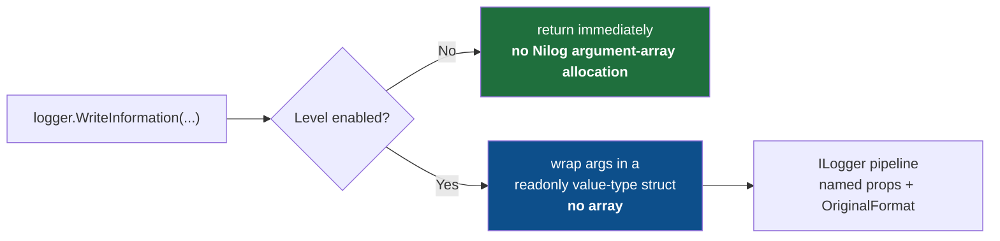

<!--  -->
<div align="center" markdown="1">

<a id="-nilog--low-allocation-structured-logging-extensions-for-net"></a>

# Nilog — Typed Structured Logging for .NET

<p align="center"><strong>Keep your ILogger pipeline. Make the logging call site work harder.</strong></p>

[](https://github.com/gcfernando/nilog-dotnet-logging/actions/workflows/repository-standards.yml) [](https://gcfernando.github.io/nilog-dotnet-logging/)

> **Start here:** [Install and start](#guide-quick-start) · [Choose an API](#guide-choosing-the-right-method) · [Read the measurements](#guide-benchmarks) · [Explore the analyzers](#guide-static-analysis-niloganalyzers)

**Read online:** [Documentation website](https://gcfernando.github.io/nilog-dotnet-logging/) · [All guides](documentation.md)

<a id="high-performance-c-structured-logging-extensions-for-microsoftextensionslogging"></a>

High-performance C# structured logging extensions for `Microsoft.Extensions.Logging`.

**Typed message-template overloads reduce call-site allocations while preserving your existing `ILogger` pipeline and sinks.**

[](https://www.nuget.org/packages/Nilog)
[](https://github.com/gcfernando/nilog-dotnet-logging/blob/main/LICENSE)
[](https://dotnet.microsoft.com)
[](#-static-analysis-niloganalyzers)

</div>

<div align="center" markdown="1">
<samp>

[**Why?**](#-why-nilog) · [**vs Others**](#-nilog-vs-the-alternatives) · [**Benchmarks**](#-benchmarks) · [**Install**](#-install) · [**Quick start**](#-quick-start) · [**Pick a method**](#-choosing-the-right-method) · [**Features**](#-features) · [**Structured**](#-structured-logging-end-to-end) · [**Config**](#-optional-advanced-configuration) · [**Analyzer**](#-static-analysis-niloganalyzers) · [**Recipes**](#-recipes) · [**Best practices**](#-best-practices) · [**Migrate**](#-migrating-to-nilog) · [**API**](#-api-reference) · [**How**](#-how-it-works) · [**FAQ**](#-faq)

</samp>
</div>

<details markdown="1">
<summary><b>📑 Full table of contents</b></summary>

<br>

- [⚠️ Limitations](#-limitations)
- [⚡ Why Nilog?](#-why-nilog)
- [🆚 Nilog vs the alternatives](#-nilog-vs-the-alternatives)
- [📊 Benchmarks](#-benchmarks)
  - [Disabled path](#disabled-path-level-filtered-off)
  - [Enabled path](#enabled-path-message-rendered)
  - [Scopes](#scopes-single-keyvalue-null-scope-sink)
  - [Parallel and sustained load](#parallel-and-sustained-load)
  - [Real ASP.NET Core application](#real-aspnet-core-application-kestrel-loopback-32-client-workers-3-alternating-rounds)
- [📦 Install](#-install)
- [🚀 Quick start](#-quick-start)
- [🧭 Choosing the right method](#-choosing-the-right-method)
- [✨ Features](#-features)
- [🧩 Structured logging, end to end](#-structured-logging-end-to-end)
- [⚙️ Optional advanced configuration](#-optional-advanced-configuration)
- [🔍 Static analysis (Nilog.Analyzers)](#-static-analysis-niloganalyzers)
- [🍳 Recipes](#-recipes)
  - [ASP.NET Core](#aspnet-core-controller--minimal-api)
  - [Worker / background service](#worker--background-service-hot-loop)
  - [Azure Functions (isolated worker)](#azure-functions-isolated-worker)
  - [Custom JSON exception reports](#custom-json-exception-reports)
  - [Works with Serilog as the sink](#works-with-serilog-as-the-sink)
- [✅ Best practices](#-best-practices)
- [🔀 Migrating to Nilog](#-migrating-to-nilog)
- [📖 API reference](#-api-reference)
- [🔬 How it works](#-how-it-works)
- [🏭 Production readiness](#-production-readiness)
- [🔒 Thread safety and lifecycle](#-thread-safety-and-lifecycle)
- [❓ FAQ](#-faq)
- [🛠️ Build, test, benchmark](#-build-test-benchmark)
- [🗺️ Roadmap](#-roadmap)

</details>

---

## 🔎 Overview

Nilog helps .NET teams reduce logging overhead without replacing their logging infrastructure. It keeps the familiar `ILogger` pipeline, structured `{Named}` templates, and existing sinks — while avoiding unnecessary allocations on common hot-path logging calls.

> Conventional templated `ILogger` extensions with value arguments can allocate a **`params object[]` at the call site** — even
> when the level is switched off and the message is thrown straight in the bin. On a hot path
> that is millions of pointless allocations and a busy garbage collector.
>
> **Nilog uses readonly value-type state for typed arguments.** After warmup, a disabled typed call allocates **nothing** inside Nilog
> and returns in about **2 ns** (measured, v1.0.6). Microsoft's own `LoggerMessage.Define` /
> `[LoggerMessage]` achieve the same disabled-path cost; Nilog's difference is that it needs no
> per-message declaration.

```csharp
using Nilog;

logger.WriteInformation("User {UserId} ordered {Count} items", userId, count);
// Avoids the call-site argument array when this binds to a typed overload.
// Enabled formatting and provider processing can still allocate.
```

## ✨ Features

### 🎚️ Six levels, two styles

```csharp
logger.WriteTrace("...");
logger.WriteDebug("...");
logger.WriteInformation("...");
logger.WriteWarning("...");
logger.WriteError("...");
logger.WriteCritical("...");
```

When the level is decided at runtime, use the static API:

```csharp
LogLevel level = isVerbose ? LogLevel.Debug : LogLevel.Information;
Nilogger.Log(logger, level, "Processing {Job}", jobId);
```

### 🧱 Structured logging without the allocation

One to **sixteen** suitably typed arguments can bind to **strongly-typed** overloads — no call-site argument array, and no Nilog allocation after warmup
when the level is off (1–5 are hand-written; 6–16 are source-generated, **extended to 16 in v1.0.4**):

```csharp
logger.WriteInformation("Order {Id} total {Amount:C}", orderId, amount);
logger.WriteInformation("User {UserId} bought {Sku} x{Qty} in {Region}", userId, sku, qty, region);
logger.WriteInformation("Order {Id} for {User} via {Carrier} to {City}, {Country} ({Tier}) ref {Ref} at {Ts}",
    orderId, user, carrier, city, country, tier, refId, ts); // 8 args — zero-array
logger.WriteInformation("{A} {B} {C} {D} {E} {F} {G} {H} {I}", a, b, c, d, e, f, g, h, i);
// 9 args — still typed and zero-alloc on the disabled path (NEW in v1.0.4)
```

Seventeen or more arguments transparently fall back to the familiar `params` form:

```csharp
logger.WriteInformation("{A} {B} {C} … {Q}", a, b, c, /* … */ q); // 17+ → params object[]
```

Standard template niceties all work — escaping and alignment/format specifiers included:

```csharp
logger.WriteInformation("Progress {Percent,3}% of {{total}}", 7);   // "Progress   7% of {total}"
logger.WriteInformation("Id {Id:000}", 42);                          // "Id 042"
```

<details markdown="1">
<summary><b>🧯 Rich exception reports</b></summary>

<br>

```csharp
catch (Exception ex)
{
    // One-line summary at Error
    logger.WriteErrorException(ex, title: "Payment failed");

    // Or the full report: stack trace + a walk of inner / aggregate exceptions
    logger.WriteErrorException(ex, title: "Payment failed", moreDetailsEnabled: true);
}
```

The built-in formatter produces an aligned, readable block:

```text
Timestamp      : 2026-06-15T10:21:38.5116876Z
Title          : Payment failed
Exception Type : System.InvalidOperationException
Message        : Could not load user profile
HResult        : -2146233079
Source         : MyApp.Billing

Stack Trace    :
   at MyApp.Billing.LoadProfile() ...

---- Inner Exceptions ----
> Exception Type : System.Collections.Generic.KeyNotFoundException
> Message        : profile 'alice' not found in cache
```

> [!NOTE]
> **Seeing the verbose report squashed onto one line in the console?** The report helpers produce
> multi-line text when `moreDetailsEnabled: true`. For a `SimpleConsole`
> configuration, use `o.SingleLine = false` to retain that layout. Other providers can encode,
> flatten or display line breaks differently; verify the actual output configuration.
>
> ```csharp
> builder.AddSimpleConsole(o => o.SingleLine = false); // keep multi-line reports
> ```

Don't like the format? Swap it out globally (set it back to `null` to restore the default):

```csharp
Nilogger.ExceptionFormatter = (ex, title, verbose) =>
    JsonSerializer.Serialize(new { title, type = ex.GetType().Name, ex.Message });
```

</details>

<details markdown="1">
<summary><b>🏷️ Scopes, the easy way</b></summary>

<br>

```csharp
// Single-pair scope — small wrapper allocation (~80 B measured in v1.0.6)
using (logger.WriteScope("RequestId", requestId))
{
    logger.WriteInformation("Handling request");   // carries RequestId

    // NEW in v1.0.4 — typed multi-pair scopes: no dictionary, no array copy
    using (logger.WriteScope("UserId", userId, "Tenant", tenant))  // WriteScope<T1,T2>
    {
        logger.WriteWarning("Quota at {Percent}%", 90);  // carries RequestId + UserId + Tenant
    }
}

// 3-pair typed scope (WriteScope<T1,T2,T3>) — used in Nilog.Function for correlation context
using (logger.WriteScope("OrderId", orderId, "CustomerId", customerId, "Currency", "GBP"))
{
    logger.WriteInformation("Order opened");
}

// 4-pair typed scope (WriteScope<T1,T2,T3,T4>)
using (logger.WriteScope("Region", "eu-west-1", "Az", "az-1", "Host", "node-01", "Pod", "pod-7b"))
{
    logger.WriteDebug("Infrastructure context attached");
}

// Dictionary scope still supported for larger or dynamic sets
using (logger.WriteScope(new Dictionary<string, object> { ["Key"] = value, /* … */ }))
{
    logger.WriteInformation("Dynamic context");
}
```

Single-pair scopes allocate a small wrapper (~80 B measured in v1.0.6, versus 240 B for `BeginScope`). The typed
2–4 pair overloads (`WriteScope<T1,T2>` etc.) use readonly structs internally — no dictionary heap
allocation, no array copy. For five or more pairs, pass an `IDictionary` or
`IReadOnlyDictionary`; Nilog's allocation-light `SmallScopeWrapper` path handles up to four
entries, `ScopeWrapper` handles five or more. The key/value pairs are copied, so replacing dictionary entries
afterwards does not replace the captured pairs. This is a shallow copy: mutable value objects remain shared.

</details>

<details markdown="1">
<summary><b>🔌 Optional: draining a buffering sink on shutdown</b></summary>

<br>

```csharp
Nilogger.UseAsyncSinkProvider((level, message, ex) => level >= LogLevel.Information);
await Nilogger.FlushAsync();   // no callbacks registered → zero-allocation no-op
```

`FlushAsync` is a **real flush** (since v1.0.3): a buffering/batching sink calls
`Nilogger.RegisterFlush(cancellationToken => DrainAsync(cancellationToken))` once, and every
subsequent `Nilogger.FlushAsync()` awaits every registered callback in order. If no sink ever
registers — which is the normal case for Console/Serilog/NLog/OpenTelemetry-style sinks that
flush themselves — `FlushAsync` stays exactly what it always was: `Task.CompletedTask` returned
synchronously with **0 allocations**. This hook only matters if you write or consume a custom
buffering sink; most applications never need to touch it.

</details>

---

## ⚡ Why Nilog?

|  |  |
|--|--|
| 🚀 **Zero-alloc disabled path** | Warmed typed calls avoid Nilog per-call allocations when disabled. Exact-zero tests cover representative arities through 16; historical timings describe the external harness below. |
| 🔥 **Leaner than MEL extensions when enabled** | In v1.0.6 measurements Nilog allocates less than the conventional extensions at 1–6 args; it is *not* faster than `Define`/`[LoggerMessage]` at 1–3 args and equals the conventional extension at 9 args. See [Benchmarks](#-benchmarks). |
| 🆕 **6–16 arg typed overloads** | Source-generated overloads reach **sixteen** arguments with a zero-allocation disabled path. |
| 🆕 **Typed multi-pair scopes (v1.0.4)** | `WriteScope<T1,T2>`, `WriteScope<T1,T2,T3>`, `WriteScope<T1,T2,T3,T4>` — no dictionary allocation, no array copy for the most common scope shapes. |
| 🆕 **Compact exception report (v1.0.4)** | `WriteErrorException(ex, moreDetailsEnabled: false)` has a **< 300 B** allocation gate for a short sample report — down from ≈ 992 B — for a single-line `[Title] Type: Message` summary. |
| 🆕 **WriteError/WriteCritical typed no-exception** | `logger.WriteError("Failed {Id}", id)` can use typed state without a call-site array; disabled typed calls return before boxing. |
| 🆕 **Span-based rendering (1–8 args)** | Plain `{Name}` templates with output fitting 256 characters use a stack buffer and allocate the final string. Formatted/long output falls back; 9–16-argument rendering builds an `object?[]`. |
| 🆕 **Real `FlushAsync` (v1.0.3)** | `RegisterFlush(...)` lets buffering sinks drain on `FlushAsync()`; a zero-allocation no-op when nothing is registered. |
| 🆕 **8 analyzer rules + a code fix** | `Nilog.Analyzers` flags interpolation (NILOG001, one-click fix), count mismatch (002), concatenated templates (003), duplicate (004), positional (005), exception-as-value (006), malformed (007), and non-PascalCase (008). |
| 🆕 **Native AOT analysis** | `IsAotCompatible=true` enables SDK compatibility analysis. Validate the complete host, providers and publish settings for application-level compatibility. |
| 🔌 **Existing MEL pipeline** | Uses the supplied `ILogger` and standard structured-state conventions. Repository interop tests exercise a real `LoggerFactory` with a custom capture provider. |
| 🧩 **Zero setup** | Just `using Nilog;` — no DI, no registration, no config files. |
| 🧯 **Hardened formatting** | Too few values or invalid format text on the typed path can return the raw template; surplus values remain in state but are ignored in rendered text. Recoverable argument-formatting failures can render `[ToString failed: Type threw Ex]`. Validation errors (null logger/template) and provider exceptions still propagate. |
| 🧵 **Concurrent internal state & AOT analysis** | Shared state uses concurrency controls; callbacks/providers must support concurrent calls. SDK compatibility analysis is enabled for the library. |
| 🎯 **Modern & multi-target** | Ships for **.NET 8 · 9 · 10** as a single `Nilog.dll`, with XML docs and SourceLink. |

---

## 🆚 Nilog vs the alternatives

Nilog is a call-site layer over the logging pipeline you already use. The table describes
its allocation behavior for the relevant call shapes.

The comparison here concerns Nilog's call shape. Its repository tests do not establish the
behavior or cost of every overload offered by other logging libraries.

| Call shape | Nilog behavior |
| --- | --- |
| Disabled typed values (1–16) | Returns after validation and `IsEnabled`; no Nilog per-call allocation after warmup. Argument expressions run first. |
| Enabled typed values (1–8) | Value-type state; plain short messages use the stack render path. Boxing, final strings, formatting fallback and providers can allocate. |
| Enabled typed values (9–16) | Value-type state; rendering builds an `object?[]` for `string.Format`. |
| `params`/all-object call shapes or 17+ values | Can allocate the argument array before Nilog checks the level; MEL owns formatting. |
| Scopes | Typed 2–4-pair forms avoid dictionary/array construction; boxing, wrappers and provider scope allocation remain. |
| Existing providers | Uses standard MEL state and the caller's `ILogger`; provider-specific export behavior needs application testing. |

<a id="in-plain-words"></a>

Use the historical [benchmark tables](#-benchmarks) for their stated harness, including the
comparison with `LoggerMessage.Define` and `[LoggerMessage]`.

---

<a id="guide-quick-start"></a>

## 🚀 Quick start

```csharp
using Microsoft.Extensions.Logging;
using Nilog; // <- that's the whole setup

using ILoggerFactory factory = LoggerFactory.Create(b => b.AddConsole());
ILogger logger = factory.CreateLogger("App");

// Plain message — identity formatter; provider costs depend on its implementation
logger.WriteInformation("Service started");

// Structured, strongly-typed, zero array allocation
logger.WriteInformation("User {UserId} signed in from {Ip}", 42, "10.0.0.1");

// An exception with context
try { Risky(); }
catch (Exception ex)
{
    logger.WriteError("Checkout failed for cart {CartId}", ex, cartId);
}
```

Everything still flows through the standard pipeline, so structured properties (`UserId`, `Ip`, …)
and the original template are available to MEL providers. Exported field names, scope support and
rendered output depend on the provider configuration.

---

<a id="-install"></a>

<a id="️-optional-advanced-configuration"></a>

## 📦 Prerequisites and installation

```bash
dotnet add package Nilog
```

```xml
<PackageReference Include="Nilog" Version="1.0.6" />
```

Optional, build-time-only static-analysis package:

```xml
<PackageReference Include="Nilog.Analyzers" Version="1.0.6" PrivateAssets="all" />
```

### Compatibility

| | |
|--|--|
| **Runtimes** | .NET 8.0, .NET 9.0, .NET 10.0 |
| **Language** | C# (latest) |
| **Depends on** | `Microsoft.Extensions.Logging.Abstractions`, `Microsoft.Extensions.ObjectPool` |
| **Provider contract** | Standard MEL state and `{OriginalFormat}`; custom-provider interop tests are included. Validate specific sinks in the consuming application. |
| **Native AOT / trimming** | `IsAotCompatible=true`; validate the complete consuming app |
| **Concurrency** | Internal shared state uses concurrency controls; user callbacks and providers own their thread safety |

---

<a id="-optional-advanced-configuration"></a>

## ⚙️ Configuration

> [!IMPORTANT]
> **No Nilog-specific configuration or DI registration is required for normal use.** Use the
> existing `ILogger` and providers from your application. Nilog adds no service registration,
> logger factory, config file or manual initialization. You do not need
> `IsEnabled(...)` guards around calls with cheap or already-built arguments. Guard expensive argument computation explicitly. This section is entirely optional and
> most applications will never need it.

### ✅ Normal Nilog usage (no setup)

```csharp
using Nilog;

logger.WriteInformation("User {UserId} logged in", userId);
```

That's it. `logger` is whatever `ILogger` your application already has.

### 🔧 Standard Microsoft.Extensions.Logging configuration

Levels, categories, and providers are **not** Nilog settings — they belong to MEL and keep working
exactly as before:

```csharp
builder.Logging
    .SetMinimumLevel(LogLevel.Information)
    .AddFilter("Microsoft", LogLevel.Warning)
    .AddConsole();
```

Nilog's `IsEnabled` checks honour all of this automatically; there is nothing Nilog-specific to
configure to make filtering work.

### 🎚️ Minimum log level

Set the minimum level in your host's MEL configuration. Nilog evaluates `ILogger.IsEnabled` before
formatting a message, so a level filtered out by the host (such as `Debug` in Release) stays on
Nilog's zero-allocation disabled path.

**C# — choose a level at compile time**

```csharp
using Microsoft.Extensions.Logging;

#if DEBUG
// Debug build: include diagnostic application logs.
builder.Logging.SetMinimumLevel(LogLevel.Debug);
#else
// Release build: omit Debug and Trace logs by default.
builder.Logging.SetMinimumLevel(LogLevel.Information);
#endif

builder.Logging
    .AddFilter("Microsoft", LogLevel.Warning)
    .AddConsole();
```

`DEBUG` is defined by the Debug configuration; it is not defined by the Release configuration.
The sample function app uses this exact pattern.

**JSON — choose a level by environment**

For ASP.NET Core and worker hosts that load the standard configuration files, keep the production
default in `appsettings.json`, then override it in the environment-specific file:

```jsonc
// appsettings.json (used for Release/production by default)
{
  "Logging": {
    "LogLevel": {
      "Default": "Information",
      "Microsoft": "Warning"
    }
  }
}
```

```jsonc
// appsettings.Development.json (used when ASPNETCORE_ENVIRONMENT=Development)
{
  "Logging": {
    "LogLevel": {
      "Default": "Debug",
      "Microsoft": "Information"
    }
  }
}
```

`appsettings.{Environment}.json` is selected by the host environment, not by the C# build
configuration. Use `Development` for locally running Debug builds and `Production` (or no
override) for Release deployments; if needed, add an explicit `appsettings.Production.json` with
the same `Information` level.

### 🧰 Optional Nilog hooks

A handful of **static, process-wide** settings on `Nilogger` exist for advanced scenarios — custom
exception formatting, draining a custom buffering sink, or tuning the template cache. None of them
are required, and sensible defaults apply if you never touch them:

```csharp
using Microsoft.Extensions.Logging;
using Nilog;

// Customise how exceptions are rendered by WriteErrorException / WriteCriticalException.
// Assign null at any time to restore the built-in formatter.
Nilogger.ExceptionFormatter = (exception, title, verbose) =>
    $"[{title}] {exception.GetType().Name}: {exception.Message}";

// Decide which entries a custom async/batch sink should keep (default: keep everything).
Nilogger.UseAsyncSinkProvider((level, message, exception) => level >= LogLevel.Information);

// Only needed if a buffering sink registered a flush callback via RegisterFlush.
// With nothing registered this is a zero-allocation no-op.
await Nilogger.FlushAsync();

// Only needed for deterministic teardown in short-lived hosts/tests. Nilog already performs
// a final timestamp refresh automatically on process exit, so ordinary apps never call this.
Nilogger.ShutdownUtcTimer();
```

| Setting                                                              | Default                      | What it controls                                                                                                                                                                                                                             |
| --------- | --------- | ------------------ |
| `Nilogger.ExceptionFormatter`                                        | compact by default; verbose when requested      | How `WriteErrorException` / `WriteCriticalException` render an exception. Set to `null` to restore the default.                                                                                                                              |
| `Nilogger.UseAsyncSinkProvider(filter)` → `Nilogger.AsyncSinkFilter` | keep everything              | Predicate consulted by a custom async/batch sink. Passing `null` leaves the current filter unchanged.                                                                                                                                        |
| `Nilogger.MaxTemplateCacheEntries`                                   | 10,000                       | Maximum parsed templates to cache. When the limit is hit, new templates are still parsed correctly but not stored, preventing unbounded memory growth from interpolated templates.                                                           |
| `Nilogger.RegisterFlush(callback)` / `UnregisterFlush(callback)`     | none registered              | Lets a buffering/batching sink register how to drain itself so `FlushAsync` can actually flush it.                                                                                                                                           |
| `Nilogger.FlushAsync(cancellationToken)`                             | `Task.CompletedTask` (no-op) | **Real flush** when one or more callbacks are registered via `RegisterFlush` — awaits each in order. Stays a zero-allocation no-op when nothing is registered.                                                                               |
| `Nilogger.ShutdownUtcTimer()`                                        | auto on process exit         | There is no background timer to stop — the UTC timestamp cache already refreshes lazily on read. This forces one final refresh for deterministic teardown; kept for source/binary compatibility. Idempotent and safe to call more than once. |

The shared template dictionary defaults to 10,000 entries and 1,024-character templates.
`MaxTemplateCacheEntries = 0` disables dictionary admission; negative values are ignored. Lowering
the entry limit below the current count clears the dictionary. `MaxCachedTemplateLength` ignores
non-positive values and does not evict existing entries when lowered. `ClearTemplateCache()` and
`TemplateCacheCount` concern the dictionary, not the per-thread last-template slots. A thread can
retain one formatter for a template up to 256 characters after dictionary clearing or disabling.
Set limits before concurrent logging; the admission tests do not establish an instantaneous
process-memory bound while configuration is changed concurrently.

Flush reads a snapshot of registrations and awaits callbacks sequentially. Duplicate registrations
run repeatedly; unregister removes one match. Failures are aggregated while later callbacks are
attempted. Caller cancellation stops starting callbacks and abandons waiting on an incomplete task;
previous failures are retained alongside cancellation. It cannot interrupt synchronous callback work
or forcibly stop a task. Separate `FlushAsync` calls can overlap, so callbacks must handle that if
applicable. With no callbacks, even a canceled token returns the completed no-op task.

### 📁 Configuration files and hosts

Nilog does not define a configuration section or read configuration files itself. It uses the
`ILogger` supplied by your host, so configure that host's
`Microsoft.Extensions.Logging` pipeline:

| Where | Supported? | How it affects Nilog |
| --- | :---: | --- |
| C# startup code (`Program.cs`) | Yes | Configure `builder.Logging` or `LoggerFactory` with levels, filters, and providers. |
| `appsettings.json` / `appsettings.{Environment}.json` | Yes | Use the standard `Logging:LogLevel` section when the host loads JSON configuration. |
| Azure Functions `host.json` | Yes, for an Azure Functions host | Use its `logging.logLevel` section to configure Functions host logging. This is not used by ordinary ASP.NET Core or worker-service hosts. |
| `launchSettings.json` | Indirectly | It selects a launch profile and can set environment variables such as `ASPNETCORE_ENVIRONMENT`; it does not configure Nilog or logging levels by itself. |
| Other `settings.json` files | Only if your host loads them | Nilog has no `Nilog` settings schema. Load and bind such a file in your application, then configure MEL in C# or map its values into the standard logging configuration. |

For example, select the environment in a launch profile to load the matching
`appsettings.{Environment}.json` level rules:

```jsonc
// Properties/launchSettings.json
{
  "profiles": {
    "MyApp": {
      "commandName": "Project",
      "environmentVariables": {
        "ASPNETCORE_ENVIRONMENT": "Development"
      }
    }
  }
}
```

For Azure Functions, configure host-level filters in `host.json`. The included
[`Nilog.Function`](https://github.com/gcfernando/nilog-dotnet-logging/tree/main/Nilog/Nilog.Function) sample uses this form:

```jsonc
// host.json
{
  "version": "2.0",
  "logging": {
    "logLevel": {
      "default": "Information",
      "Nilog.Function": "Debug"
    }
  }
}
```

---

<a id="-before---after"></a>

## 💡 Usage

<table>
<tr>
<th>❌ Plain <code>Microsoft.Extensions.Logging</code></th>
<th>✅ Nilog</th>
</tr>
<tr>
<td>

```csharp
// Allocates an object[] + boxes the ints
// on EVERY call — even if Debug is off.
logger.LogDebug(
    "User {Id} did {Action}",
    id, action);
```

</td>
<td>

```csharp
// Ordinary readonly value-type state. No Nilog allocation when
// disabled; less allocation when enabled.
logger.WriteDebug(
    "User {Id} did {Action}",
    id, action);
```

</td>
</tr>
</table>

---

<a id="guide-choosing-the-right-method"></a>

## 🧭 Choosing the right method

A quick map from "what I want to log" to "what to call":

Allocation notes below describe Nilog's work after warmup. Argument expressions run before the
call; enabled providers can allocate independently.

| I want to… | Call | Allocation behavior |
| --- | --- | --- |
| Log a constant message | `logger.WriteInformation("Started")` | Identity formatter; no new message string inside Nilog. |
| Log 1–16 structured values | `logger.WriteInformation("User {Id}", id)` | No call-site array when typed; disabled path allocates nothing inside Nilog. Enabled rendering costs depend on arity/format. |
| Log 17+ values | `logger.WriteInformation("{A} … {Q}", …)` | `params` array and value boxing can occur before the guard. |
| Log an error with an exception | `logger.WriteError("Failed {Id}", ex, id)` | Typed context avoids a call-site array; formatting/provider work can allocate. |
| Log an error without an exception | `logger.WriteError("Validation failed {Id}", id)` | Same typed disabled-path behavior. |
| Render a compact exception report | `logger.WriteErrorException(ex, "Title")` | Allocates report text; the short allocation-gate fixture targets <300 B, not arbitrary reports. |
| Render a verbose report | `logger.WriteErrorException(ex, "Title", moreDetailsEnabled: true)` | Pooled builder, final string and other formatting work can allocate. |
| Choose a runtime level | `Nilogger.Log(logger, level, "…", a, b)` | Typed values have the same disabled-path behavior; dedicated exception/params forms differ. |
| Attach one scope pair | `using (logger.WriteScope("Key", value)) { … }` | Value/state boxing, fallback wrapper and provider costs; historical sample measured 80 B with a null-returning scope provider. |
| Attach 2–4 scope pairs | `using (logger.WriteScope("K1", v1, "K2", v2)) { … }` | Avoids a dictionary/array; values/state/provider scope can allocate. |
| Drain a buffering sink | `RegisterFlush(...)` then `await FlushAsync()` | Only registered callbacks are invoked; no registrations returns `Task.CompletedTask`. |
| Check template usage | add `Nilog.Analyzers` | Build-time diagnostics for supported call-site patterns. |

Pass exceptions after the message to `WriteError`/`WriteCritical`. Up to 16 suitably typed
values avoid a **call-site** array; this is not a zero-allocation enabled-formatting guarantee.

---

## 🧩 Structured logging, end to end

A single call carries three things to your sink — the **rendered message**, the **named
properties**, and the **original template** (`{OriginalFormat}`) — using typed state:

```csharp
logger.WriteInformation("User {UserId} bought {Sku} x{Qty}", 42, "A-100", 3);
```

| What the sink receives | Value                               |
| ------------------------ | ------- |
| Rendered message       | `User 42 bought A-100 x3`           |
| `UserId`               | `42`                                |
| `Sku`                  | `"A-100"`                           |
| `Qty`                  | `3`                                 |
| `{OriginalFormat}`     | `User {UserId} bought {Sku} x{Qty}` |

A provider that consumes MEL structured state can export these named values and the original
template. Check the provider's mapping, scope support and formatting in the consuming application.

---

<a id="guide-static-analysis-niloganalyzers"></a>

## 🔍 Static analysis (Nilog.Analyzers)

Stable templates preserve named values and allow parsed-template reuse. Interpolation evaluates
before Nilog sees the call and embeds the values into message text instead of structured fields:

```csharp
logger.WriteInformation($"User {id} signed in"); // values become message text rather than structured fields
```

`Nilog.Analyzers` is a separate, **opt-in** Roslyn analyzer package (**8 rules + a code fix** —
covering Nilog-specific call-site patterns) that checks this and seven related usage patterns. It is **not** referenced by `Nilog.Core` — installing `Nilog`
does not pull it in automatically.

### Why this one mistake matters so much

| Without the analyzer                                                                                             | With `Nilog.Analyzers`                                  |
| --- | --- |
| `$"User {id} signed in"` compiles silently                                                                       | `NILOG001` warning at build time, in your IDE and in CI |
| Interpolation evaluates before the call; a new message string may be built                                                           | Reported when the direct expression is analyzed                     |
| Dynamic templates with value arguments may consume cache entries; no-argument calls bypass this cache   | Warning helps identify the call; limits still apply at runtime                                           |
| `id` never becomes a structured property — your Seq/Application Insights query for `UserId = 42` returns nothing | Structured properties stay queryable                    |
| Without a diagnostic, review or testing must identify the lost structure                                                   | Discoverable by reading a compiler warning              |

### What it catches

| ID         | Severity | Condition                                                                                                        | Code fix    |
| ---- | ---------- | ----------- | :--------: |
| `NILOG001` | Warning  | Direct interpolation with a hole is passed to a recognized `WriteTrace`/`WriteDebug`/`WriteInformation`/`WriteWarning`/`WriteError`/`WriteCritical`/`Log` template parameter | ✅ one-click |
| `NILOG002` | Warning  | A constant template's hole count differs from values on a supported positional call shape                      | —           |
| `NILOG003` | Warning  | The template is built with string concatenation (`"a" + b`) or `string.Format(...)`                              | —           |
| `NILOG004` | Warning  | The same named `{Placeholder}` appears more than once (duplicate structured-property key)                        | —           |
| `NILOG005` | Info     | Positional `{0}` placeholders used instead of named `{Name}` ones                                                | —           |
| `NILOG006` | Warning  | An `Exception` is passed as a template value instead of the exception parameter                                  | —           |
| `NILOG007` | Warning  | The template is malformed — an unclosed `{` or an empty `{}` placeholder                                         | —           |
| `NILOG008` | Info     | A placeholder begins with a lowercase letter (e.g. `{userId}` → `{UserId}`)                                              | —           |

The analyzers recognize methods declared on `Nilog.Nilogger`, including reduced extension calls
and static calls. Coverage depends on the rule and argument syntax. **NILOG001** also offers
*"Convert to a literal template with arguments"* for supported interpolation shapes:

```csharp
// ❌ NILOG001 — interpolation embeds values into text (fix available for supported shapes).
logger.WriteInformation($"User {id} signed in");          // → fix → ("User {id} signed in", id)
logger.WriteError($"Order {id} failed", ex);
Nilogger.Log(logger, LogLevel.Warning, $"Retry {attempt} for {job}");

// ❌ NILOG002 — 2 placeholders, 1 argument.
logger.WriteInformation("{A} {B}", a);
// ❌ NILOG003 — concatenated template.
logger.WriteInformation("User " + id + " signed in");
// ❌ NILOG004 — duplicate keys; how collisions are handled depends on the sink.
logger.WriteInformation("{Id} retried {Id}", a, b);
// 🔵 NILOG005 (Info) — positional placeholders; prefer named ones.
logger.WriteInformation("{0} {1}", a, b);
// ❌ NILOG006 — exception passed as a value; use the exception parameter.
logger.WriteInformation("Failed {Error}", ex);
// ❌ NILOG007 — malformed template (unclosed brace).
logger.WriteInformation("Unclosed {Brace");
// 🔵 NILOG008 (Info) — placeholder name should be PascalCase.
logger.WriteInformation("User {userId}", id);

// ✅ Stable templates and separate named values; cache admission follows the configured limits.
logger.WriteInformation("User {UserId} signed in", id);
logger.WriteError("Order {OrderId} failed", ex, id);
Nilogger.Log(logger, LogLevel.Warning, "Retry {Attempt} for {Job}", attempt, job);
```

The rules inspect direct expressions and resolved method symbols, not values flowing through
locals. NILOG002 and NILOG006 skip calls with named arguments; NILOG002 also skips explicit
array/collection-expression syntax in a params slot, but does not count the contents of a variable
array. NILOG001 requires an actual interpolation hole. NILOG008 checks whether the initial character is a lowercase letter,
not a complete naming grammar. Report helpers (`WriteErrorException`/`WriteCriticalException`)
are not template-analysis entry points.

The NILOG001 fix preserves supported format/alignment syntax and inserts extracted values before
existing value arguments, after a statically exception-typed argument when present. It withholds
fixes for other named arguments, trailing array arguments and multi-line raw strings. Review the
result: null becomes `(null)` rather than interpolation's empty text; numeric formatting uses
invariant culture and provider formatting may happen later. Names are derived from identifiers or
member names, so duplicates/lowercase names may need a followup edit. These checks do not prove
that arbitrary side effects, custom formatting or exception-expression evaluation remain identical.

### Install it

```xml
<PackageReference Include="Nilog.Analyzers" Version="1.0.6" PrivateAssets="all" />
```

`PrivateAssets="all"` keeps it a build-time-only dependency — it never ships inside your output
or gets pulled transitively into anything that references your project.

Building this repo from source instead of consuming the NuGet package? Reference the analyzer
project directly with `OutputItemType="Analyzer"` so it runs at build time without becoming a
runtime dependency — exactly how [`Nilog.Function`](https://github.com/gcfernando/nilog-dotnet-logging/tree/main/Nilog/Nilog.Function) wires it in:

```xml
<ProjectReference Include="..\Nilog.Analyzers\Nilog.Analyzers.csproj"
                  OutputItemType="Analyzer" ReferenceOutputAssembly="false" />
```

### Confirm it's active

Build a project that references it and has a recognized direct interpolation with a hole:

```text
warning NILOG001: Pass a literal template with '{Name}' placeholders and separate arguments
instead of an interpolated string - interpolation defeats Nilog's zero-allocation template
cache and loses structured properties
```

If you see nothing on a known-bad line, check that the package/project reference actually has
`OutputItemType="Analyzer"` (for project references) and that the file is part of the build
(not excluded, not in `obj`/`bin`).

### Treating it as an error in CI

A warning is easy to miss in a noisy build log. Promote just this rule to an error without
affecting any other warning in the project:

```xml
<PropertyGroup>
  <!-- Promote the correctness rules; NILOG005/008 are Info-only style suggestions. -->
  <WarningsAsErrors>$(WarningsAsErrors);NILOG001;NILOG002;NILOG003;NILOG004;NILOG006;NILOG007</WarningsAsErrors>
</PropertyGroup>
```

Or scope it via `.editorconfig` instead, so it's consistent across every project in the
repository without touching each `.csproj`:

```ini
[*.cs]
dotnet_diagnostic.NILOG001.severity = error
dotnet_diagnostic.NILOG002.severity = error
dotnet_diagnostic.NILOG003.severity = error
dotnet_diagnostic.NILOG004.severity = error
```

### Suppressing a single, deliberate exception

Occasionally a genuinely dynamic message is the right call (rare — most "dynamic" messages
should be a structured argument instead). Suppress just that line, with a reason, rather than
disabling the rule project-wide:

```csharp
#pragma warning disable NILOG001 // Diagnostic-only log line; not on a hot path, structure not needed.
logger.WriteInformation($"Startup environment dump: {Environment.GetEnvironmentVariables()}");
#pragma warning restore NILOG001
```

> [!NOTE]
> The check is syntax-based: it looks at the literal expression passed directly at the call
> site. It does **not** catch interpolation hidden behind a local variable
> (`var msg = $"User {id}"; logger.WriteInformation(msg);`) — that needs data-flow analysis,
> which isn't implemented yet (tracked on the [Roadmap](#-roadmap)). It catches the
> overwhelmingly common case: the mistake made directly at the call site.

---

## 🍳 Recipes

### ASP.NET Core (controller / minimal API)

```csharp
using Nilog;

app.MapPost("/orders", (OrderRequest req, ILogger<OrdersController> logger) =>
{
    using (logger.WriteScope("CorrelationId", req.CorrelationId))
    {
        logger.WriteInformation("Creating order for {CustomerId}", req.CustomerId);
        try
        {
            var id = orders.Create(req);
            logger.WriteInformation("Order {OrderId} created", id);
            return Results.Ok(id);
        }
        catch (Exception ex)
        {
            logger.WriteError("Order creation failed for {CustomerId}", ex, req.CustomerId);
            return Results.Problem("Could not create order");
        }
    }
});
```

### Worker / background service hot loop

```csharp
public sealed class IngestWorker(ILogger<IngestWorker> logger) : BackgroundService
{
    protected override async Task ExecuteAsync(CancellationToken stoppingToken)
    {
        while (!stoppingToken.IsCancellationRequested)
        {
            var batch = await queue.DequeueAsync(stoppingToken);

            // Trace is usually OFF in prod — with Nilog this line is ~2 ns and 0 bytes.
            logger.WriteTrace("Dequeued {Count} messages", batch.Count);

            foreach (var msg in batch)
            {
                logger.WriteDebug("Processing {MessageId}", msg.Id);
            }
        }
    }
}
```

### Azure Functions (isolated worker)

Wire Nilog the way a real function app would: set the global hooks **once** at startup, choose the
minimum level by **build configuration**, and open a correlation **scope per invocation** with
worker middleware — so functions *and* injected services log through `ILogger<T>` and inherit it.

```csharp
// Program.cs
var builder = FunctionsApplication.CreateBuilder(args);
builder.ConfigureFunctionsWebApplication();

// Minimum level by build configuration — chatty in Debug, lean in Release.
#if DEBUG
builder.Logging.SetMinimumLevel(LogLevel.Debug);
#else
builder.Logging.SetMinimumLevel(LogLevel.Information);
#endif

// Global Nilog hooks — set once, process-wide.
Nilogger.ExceptionFormatter = (ex, title, verbose) => /* JSON for App Insights */ ...;
Nilogger.UseAsyncSinkProvider((level, _, _) => level >= LogLevel.Warning);

builder.UseMiddleware<RequestLoggingMiddleware>();   // correlation scope per invocation

var app = builder.Build();

// Drain registered callbacks and force a final cached UTC timestamp refresh.
app.Services.GetRequiredService<IHostApplicationLifetime>().ApplicationStopping.Register(() =>
{
    Nilogger.FlushAsync().GetAwaiter().GetResult();
    Nilogger.ShutdownUtcTimer();
});

app.Run();
```

```csharp
// One scope wraps the whole invocation — every line (in functions AND services)
// carries CorrelationId + Function without repeating them.
public sealed class RequestLoggingMiddleware(ILogger<RequestLoggingMiddleware> logger)
    : IFunctionsWorkerMiddleware
{
    public async Task Invoke(FunctionContext context, FunctionExecutionDelegate next)
    {
        using (logger.WriteScope(new Dictionary<string, object>
        {
            ["CorrelationId"] = context.InvocationId,
            ["Function"] = context.FunctionDefinition.Name,
        }))
        {
            try { await next(context); }
            catch (Exception ex)
            {
                logger.WriteCriticalException(ex, "unhandled.function.exception", moreDetailsEnabled: true);
                throw;
            }
        }
    }
}
```

> The full runnable version lives in [`Nilog.Function`](https://github.com/gcfernando/nilog-dotnet-logging/tree/main/Nilog/Nilog.Function) — an HTTP checkout
> logging sample (`POST /api/orders`) with simulated inventory, payments, shipment and readiness.
> Its retry examples log a proposed delay but do not wait. Request validation is intentionally
> minimal; this is not a production checkout implementation. The shutdown callback force-flushes
> the OpenTelemetry trace provider when present; it does not establish that every log exporter is drained.

### Custom JSON exception reports

```csharp
// At startup:
Nilogger.ExceptionFormatter = (ex, title, verbose) => JsonSerializer.Serialize(new
{
    title,
    type = ex.GetType().FullName,
    ex.Message,
    stack = verbose ? ex.StackTrace : null,
});

// Anywhere:
logger.WriteCriticalException(ex, "Database unavailable", moreDetailsEnabled: true);
```

### Works with Serilog as the sink

```csharp
// Serilog is the provider; Nilog supplies typed calls that avoid an argument array.
// Enabled allocations also depend on the provider and formatting path.
using var loggerFactory = LoggerFactory.Create(b => b.AddSerilog(
    new LoggerConfiguration().WriteTo.Console().CreateLogger()));

ILogger logger = loggerFactory.CreateLogger("App");
logger.WriteInformation("User {UserId} logged in", 42); // structured props reach Serilog
```

---

## ✅ Best practices

| Do ✅                                                                | Don't ❌                                                                                          |
| ------ | --------- |
| `logger.WriteInformation("User {Id}", id)` — templated & structured | `logger.WriteInformation($"User {id}")` — interpolation embeds values into text before the call |
| Add `Nilog.Analyzers` to catch interpolated templates at build time | Relying on code review to catch `$"..."` templates                                               |
| Keep to **≤ 16 named holes** for the zero-array path                | Pack 17+ values into one line and take the `params` array                                        |
| Pass the exception: `WriteError("msg {X}", ex, x)`                  | `WriteError("msg " + value)` — string concatenation                                              |
| Let Nilog filter calls with cheap or already-built arguments; guard expensive construction with `if (logger.IsEnabled(level))` | Assume the internal guard skips evaluation of argument expressions |
| Use `WriteScope` for request/correlation context                    | Re-log the same ids on every line                                                                |
| `using (logger.WriteScope(...))` so the scope disposes              | Forget to dispose a scope                                                                        |

---

## 🔀 Migrating to Nilog

The common named-template call shape is similar; for errors, the **argument order** changes.
Review formatting failures, null values, numeric placeholder names, scope values and provider
behavior when migrating. Nilog binds holes in occurrence order; `{0} {0}` consumes two values
rather than reusing argument zero. Serilog-specific destructuring semantics are not implemented by Nilog.

### From `Microsoft.Extensions.Logging`

| Microsoft                                | Nilog                                                                               |
| ----------- | ------- |
| `logger.LogTrace("t {A}", a)`            | `logger.WriteTrace("t {A}", a)`                                                     |
| `logger.LogDebug("…")`                   | `logger.WriteDebug("…")`                                                            |
| `logger.LogInformation("…")`             | `logger.WriteInformation("…")`                                                      |
| `logger.LogWarning("…")`                 | `logger.WriteWarning("…")`                                                          |
| `logger.LogError(ex, "Failed {Id}", id)` | `logger.WriteError("Failed {Id}", ex, id)` ⚠️ exception moves **after** the message |
| `logger.LogCritical(ex, "…")`            | `logger.WriteCritical("…", ex)`                                                     |
| `logger.BeginScope(state)`               | `logger.WriteScope(key, value)` / `logger.WriteScope(dictionary)`                   |

### From Serilog

| Serilog                                     | Nilog                                      |
| --------- | ------- |
| `log.Information("User {Id}", id)`          | `logger.WriteInformation("User {Id}", id)` |
| `log.Error(ex, "Failed {Id}", id)`          | `logger.WriteError("Failed {Id}", ex, id)` |
| `using (LogContext.PushProperty("Key", v))` | `using (logger.WriteScope("Key", v))`      |

> [!IMPORTANT]
> Microsoft's `LogError(exception, message, args)` takes the **exception first**; Nilog's
> `WriteError(message, exception, args)` takes the **message first**. Double-check that swap.

---

## 📖 API reference

All members live in namespace `Nilog`. The `Write*` methods are extension methods on `ILogger`;
`Nilogger` also exposes a static API and the global settings.

<details open markdown="1">
<summary><b>Level methods (Trace / Debug / Information / Warning)</b></summary>

<br>

```csharp
// No-exception levels — typed for 1–16 args (1–5 hand-written, 6–16 source-generated), params for 17+.
void WriteTrace      (this ILogger logger, string message, params object[] args);
void WriteTrace<T0>  (this ILogger logger, string message, T0 arg0);
void WriteTrace<T0,T1>          (this ILogger logger, string message, T0 arg0, T1 arg1);
void WriteTrace<T0,T1,T2>       (this ILogger logger, string message, T0 arg0, T1 arg1, T2 arg2);
void WriteTrace<T0,T1,T2,T3>    (this ILogger logger, string message, T0 arg0, T1 arg1, T2 arg2, T3 arg3);
void WriteTrace<T0,T1,T2,T3,T4> (this ILogger logger, string message, T0 arg0, T1 arg1, T2 arg2, T3 arg3, T4 arg4);
// …and 6–16-argument overloads generated by Nilog.SourceGenerators (extended to 16 in v1.0.4):
void WriteTrace<T0,/*…*/,T15>   (this ILogger logger, string message, T0 arg0, /*…*/, T15 arg15);

// Identical shape for WriteDebug, WriteInformation, WriteWarning.
```

</details>

<details markdown="1">
<summary><b>Error / Critical methods</b></summary>

<br>

```csharp
// Without an exception — typed for 1–16 args (no call-site array), params fallback for 17+:
void WriteError    (this ILogger logger, string message, params object[] args);
void WriteError<T0>(this ILogger logger, string message, T0 arg0);
// … T0,T1 / T0,T1,T2 / … up to …
void WriteError<T0,/*…*/,T15> (this ILogger logger, string message, T0 arg0, /*…*/, T15 arg15);

// With an exception — typed for 1–16 args (no call-site array), params fallback for 17+:
void WriteError    (this ILogger logger, string message, Exception exception, params object[] args);
void WriteError<T0>(this ILogger logger, string message, Exception exception, T0 arg0);
// … up to …
void WriteError<T0,/*…*/,T15> (this ILogger logger, string message, Exception exception, T0 arg0, /*…*/, T15 arg15);

// Identical shape for WriteCritical.
```

</details>

<details markdown="1">
<summary><b>Exception reports</b></summary>

<br>

```csharp
void WriteErrorException   (this ILogger logger, Exception ex,
                            string title = "System Error",          bool moreDetailsEnabled = false);
void WriteCriticalException(this ILogger logger, Exception ex,
                            string title = "Critical System Error", bool moreDetailsEnabled = false);
```

</details>

<details markdown="1">
<summary><b>Scopes</b></summary>

<br>

```csharp
// Single-pair — small wrapper allocation (~80 B measured in v1.0.6)
IDisposable WriteScope(this ILogger logger, string key, object value);

// Typed multi-pair — NEW in v1.0.4: no dictionary, no array, backed by readonly structs
IDisposable WriteScope<T1,T2>        (this ILogger logger, string key1, T1 val1, string key2, T2 val2);
IDisposable WriteScope<T1,T2,T3>     (this ILogger logger, string key1, T1 val1, string key2, T2 val2, string key3, T3 val3);
IDisposable WriteScope<T1,T2,T3,T4>  (this ILogger logger, string key1, T1 val1, string key2, T2 val2, string key3, T3 val3, string key4, T4 val4);

// Dictionary overloads — for dynamic or large key sets
IDisposable WriteScope(this ILogger logger, IDictionary<string, object>? context);
IDisposable WriteScope(this ILogger logger, IEnumerable<KeyValuePair<string, object>>? context);
// IReadOnlyDictionary binds to the IEnumerable overload; there is no dedicated overload.
```

</details>

<details markdown="1">
<summary><b>Static <code>Nilogger.Log</code> (runtime level)</b></summary>

<br>

```csharp
void Log                (ILogger logger, LogLevel level, string message);
void Log<T0>            (ILogger logger, LogLevel level, string message, T0 arg0);
// … typed for 1–16 args (6–16 source-generated), no call-site array …
void Log<T0,/*…*/,T15>  (ILogger logger, LogLevel level, string message, T0 arg0, /*…*/, T15 arg15);

void Log(ILogger logger, LogLevel level, string message, Exception exception, params object[] args);
void Log(ILogger logger, LogLevel level, string message, params object[] args);
void Log(ILogger logger, LogLevel level, Exception exception, string messageTemplate, params object[] args);
```

> [!NOTE]
> The `Exception` overload `Log(logger, level, message, Exception, params object[])` carries
> `[OverloadResolutionPriority(1)]` (v1.0.3), so a call with a leading `Exception` argument —
> e.g. `Log(logger, level, "{A}", someException, b, c, d, e)` — binds to it (attaching the
> exception), while a plain typed call binds to the **zero-array** `Log<T0…Tn>` overload. Typed
> overloads now reach **T0…T15** (16 args) via source generator (v1.0.4).

</details>

<details markdown="1">
<summary><b>Flush (drain buffering sinks)</b></summary>

<br>

```csharp
// A buffering/batching sink registers how to drain itself; FlushAsync awaits them all.
void RegisterFlush  (Func<CancellationToken, Task> flush);
bool UnregisterFlush(Func<CancellationToken, Task> flush);
Task FlushAsync     (CancellationToken cancellationToken = default); // 0-alloc no-op when none registered
```

</details>

<details markdown="1">
<summary><b>Global settings</b></summary>

<br>

```csharp
static Func<Exception, string, bool, string> ExceptionFormatter { get; set; }
static Func<LogLevel, string, Exception, bool> AsyncSinkFilter { get; }
static int MaxTemplateCacheEntries { get; set; }   // default 10,000; dictionary admission limit
static int MaxCachedTemplateLength { get; set; }   // default 1,024 characters
static int TemplateCacheCount { get; }
static void ClearTemplateCache();                 // shared dictionary only; thread slots remain

static void UseAsyncSinkProvider(Func<LogLevel, string, Exception, bool> filter);
static Task FlushAsync(CancellationToken cancellationToken = default);  // real flush of RegisterFlush callbacks; Task.CompletedTask when none registered
static void ShutdownUtcTimer();  // no background timer to stop; forces one final lazy-refresh for deterministic teardown
```

</details>

---

<a id="-how-it-works"></a>

## 🏗️ Architecture



A few deliberate design choices do all the work:

- **Strongly-typed overloads beat `params`.** A call with one to **sixteen** arguments binds to a
  generic overload in *normal form* (1–5 hand-written, 6–16 source-generated), which the C# compiler
  prefers over the *expanded* params form when the call binds to that typed overload.
  Calls statically typed as `object` can select the params path; inspect ambiguous call shapes.
- **`IsEnabled` precedes Nilog's formatting work.** A disabled typed call returns before
  constructing log state. C# evaluates argument expressions before entering the method,
  so an expensive `BuildPayload()` still runs. Guard expensive argument construction
  explicitly with `logger.IsEnabled(level)` when needed.
- **Value-type log state.** Arguments are wrapped in a `readonly struct` that implements
  `IReadOnlyList<KeyValuePair<string, object>>`, so structured sinks still get named properties
  and the `{OriginalFormat}` template. Providers can still box or enumerate this state;
  the final enabled-path allocation depends on the provider.
- **Span-based rendering for 1–8 typed values.** Plain `{Name}` templates can render through a
  256-character stack buffer, allocating the final string. Format/alignment suffixes, too few
  values or buffer overflow use `string.Format`; 6–8-value fallbacks allocate an argument array.
  The 9–16-value states always build an `object?[]` when their text is rendered.
- **Cached everything.** Parsed templates, `EventId`s, and a pooled `StringBuilder` are shared
  process-wide. A per-thread reference check skips the template dictionary lookup entirely when
  the same call site fires repeatedly. The UTC timestamp used in exception reports is refreshed
  lazily on read (compared against `Environment.TickCount64`) instead of via a background timer
  that used to tick every millisecond for the life of the process.
- **Identity formatter for no-arg paths.** Plain static messages use `static (s, _) => s` — the
  same trick Microsoft uses internally — bypassing all intermediate state construction.
- **Typed formatting safeguards.** Too few values or an invalid format can return raw text.
  Surplus values are ignored in text and retained in state. Recoverable argument-formatting
  errors can be sanitized; validation and provider errors still propagate. Explicit `object[]`
  calls use MEL rendering. All-`object` call shapes can select `params`; mixed types can still bind typed overloads.
- **Optional static analysis.** `Nilog.Analyzers` checks supported call-site patterns; it does
  not perform data-flow analysis or prove the behavior of providers and custom formatters.

---

## 🏭 Production readiness

| Concern               | Nilog answer                                                                                                                                                                                   |
| --------- | ------------- |
| Thread safety         | Internal shared state uses `volatile`, `Interlocked` and `ConcurrentDictionary`; provider and callback behavior remains the host's responsibility                                                                                    |
| Trimming / Native AOT | `IsAotCompatible=true` enables SDK analysis; validate trimming/AOT for the complete consuming application                                                                                                                 |
| Memory growth         | Template cache warns and stops caching new entries once `MaxTemplateCacheEntries` is reached                                                                                                   |
| Idle CPU cost         | No background timer — the UTC timestamp cache refreshes lazily on read, only when an exception is actually formatted                                                                           |
| Process shutdown      | A final UTC refresh runs automatically on `ProcessExit` / `DomainUnload`; call `ShutdownUtcTimer()` for deterministic teardown (kept for compatibility — there is no timer to dispose anymore) |
| Formatting robustness | Typed formatting handles too few values/invalid format with raw-text fallback and can sanitize recoverable value-formatting failures; surplus values remain in state. Null template values render `(null)`.                                 |
| Sink compatibility    | Uses standard structured-state conventions; the repository tests a custom provider through real `LoggerFactory`, not each named third-party sink                                                            |
| Supported frameworks  | .NET 8, 9, 10                                                                                                                                                                                  |

---

## 🔒 Thread safety and lifecycle

- **Internal shared caches and registration state use concurrency controls.** The template cache and registration mechanisms support concurrent use. Custom formatters,
  flush callbacks and logging providers must also support the host's calling pattern.
- **No runtime reflection-based template discovery.** The library enables SDK trimming/AOT analysis; validate the complete host.
- **No background timer.** The UTC timestamp cache refreshes lazily when read, not on a
  schedule — there is nothing running, and therefore nothing to leak, while the process is idle.
  A final refresh runs automatically on `ProcessExit` and `DomainUnload`. Call
  `Nilogger.ShutdownUtcTimer()` yourself only for deterministic teardown (it is idempotent).
- **Global settings are process-wide.** `ExceptionFormatter` and `AsyncSinkFilter` affect the
  whole process; set them once at startup.

---

<a id="-build-test-benchmark"></a>

<a id="️-build-test-benchmark"></a>

## 🧪 Development and testing

The following commands are for repository contributors. Package consumers only need a compatible .NET application, its existing `ILogger` provider and the Nilog package. For current test discovery, run `dotnet test Nilog.Tests/Nilog.Tests.csproj --list-tests -f net10.0` from the inner `Nilog/` directory; discovery counts are not a passing test report.


Install the exact .NET SDK version specified in the repository-root `global.json`
(currently **10.0.401**) and the .NET 8, 9, and 10 runtimes to run all tests.
Run the commands below from the `Nilog` directory. CI and release builds use the
same pinned SDK: SDK updates can change the implicit `Microsoft.NET.ILLink.Tasks`
dependencies, so update `global.json` and regenerate the affected `packages.lock.json`
files together with `dotnet restore Nilog.sln --force-evaluate`, then verify
`dotnet restore Nilog.sln --locked-mode` before committing an SDK upgrade.

```bash
# Restore exactly the locked dependencies, then build all targets
dotnet restore Nilog.sln --locked-mode
dotnet build -c Release --no-restore

# Run the unit and analyzer tests across their target frameworks
dotnet test -c Release --no-restore

# See every feature in action — a real-world e-commerce checkout walkthrough
dotnet run -c Release --project Nilog.Demo -f net10.0

# Run the repository benchmark suites (21 classes; distinct from the external harness)
dotnet run -c Release --project Nilog.Benchmark -f net10.0
#   ...or one suite:  -- --filter "*HighArityExtendedBenchmarks*"
#   ...or faster:     -- --job short
```

The root `.github/workflows/ci.yml` runs core and analyzer tests on Linux. The nested
`Nilog/.github/workflows/ci.yml` is retained historical configuration and is outside GitHub's root
workflow discovery. The release workflow gates on **core tests**, packages **Nilog** and symbols,
per-framework DLL archives, and self-contained net10 demo archives for Linux/Windows x64. It does
not package/publish `Nilog.Analyzers` or rerun analyzer tests. Manual release-workflow runs build
artifacts; tag/UI release events can attach assets and publish to NuGet when the configured secret
is present. Review that workflow before a release; none of these publication steps are needed to
build or review documentation.

**Project layout**

| Project                  | What it is                                                                                                                                                                               |
| --------- | ------------ |
| `Nilog.Core`             | the library (packs as `Nilog`)                                                                                                                                                           |
| `Nilog.SourceGenerators` | build-time generator that emits the 6–16 arg zero-array overloads into `Nilog.dll`                                                                                                       |
| `Nilog.Tests`            | xUnit suite across net8/9/10 (incl. real-pipeline interop, allocation gate, typed scope tests)                                                                |
| `Nilog.Analyzers`        | Roslyn analyzer package — `NILOG001`–`NILOG008` + a NILOG001 code fix, opt-in, not referenced by `Nilog.Core`                                                                            |
| `Nilog.Analyzers.Tests`  | xUnit suite for the analyzer and code fix across net8/9/10                                                                                                       |
| `Nilog.Demo`             | runnable, commented tour — every feature against a real-world checkout scenario                                                                                                          |
| `Nilog.Function`         | net10 Azure Functions sample — correlation scopes, simulated checkout, analyzer reference and trace-provider ForceFlush callback |
| `Nilog.Benchmark`        | BenchmarkDotNet suites — 21 classes covering selected call shapes and workloads                                                                                                                          |

---

<a id="guide-benchmarks"></a>

## 📊 Benchmarks

> [!IMPORTANT]
> **Historical reported results.** Nilog's measurable advantage is the **disabled path** (no allocation, ~2–3 ns, versus
> 17–43 ns / 56–272 B for conventional Microsoft extension methods) and, on the **enabled path, lower
> allocation and time than conventional extensions for 1–6 typed args**. Against Microsoft's *optimized*
> APIs (`LoggerMessage.Define` and `[LoggerMessage]` source generation), Nilog is **roughly equal on
> the disabled path (both ~0 allocation) and not faster on the enabled path**; at 9 args its enabled
> allocation is equal to the conventional extension and 3.6× that of the source generator.
> Nilog's value is convenience (no per-message declaration) with near-optimized cost — not that it beats
> the source generator.

> [!NOTE]
> **v1.0.6 measurements** — BenchmarkDotNet 0.15.8, **.NET 10.0.12**, Intel Core Ultra 7 265H (16 logical cores),
> Windows 11, SDK 10.0.401. Job: **3 launches × (5 warmup + 12 iterations)**, workstation concurrent GC,
> run from an **external harness that references the packed v1.0.6 `Nilog` NuGet package**.
> Sink: a logger whose `IsEnabled` is `false` (disabled) or `true` and which renders the message (enabled).
> Mean ± StdDev shown in the details below. Single-digit-ns rows are close to timer/loop-overhead resolution:
> treat differences below ~1 ns (e.g. `Define` 0.6 ns vs `[LoggerMessage]` 0.1 ns) as *measurement
> artifacts*, not real differences.
> The external packed-package harness is not included in this checkout. The [repository benchmark suites](#-build-test-benchmark) let you measure local behavior, but do not reproduce that external harness exactly. These historical figures were not rerun for this documentation review.

### Disabled path (level filtered off)

| Typed args        | MEL extension   | `LoggerMessage.Define`   | `[LoggerMessage]` | **Nilog**        |
| :---: | :---: | :---: | :---: | :---: |
| 1                 | 17.2 ns / 56 B  | 0.6 ns / 0 B             | 0.1 ns / 0 B      | **2.0 ns / 0 B** |
| 3                 | 22.7 ns / 104 B | 1.5 ns / 0 B             | 0.9 ns / 0 B      | **1.9 ns / 0 B** |
| 6                 | 38.3 ns / 200 B | 2.1 ns / 0 B             | 1.7 ns / 0 B      | **2.0 ns / 0 B** |
| 9                 | 42.6 ns / 272 B | n/a (Define supports ≤6) | 2.6 ns / 0 B      | **2.8 ns / 0 B** |
| exception (1 arg) | 20.8 ns / 56 B  | —                        | —                 | **2.1 ns / 0 B** |

These historical rows report a disabled-path advantage over conventional extensions; very small
timing differences need the original measurement uncertainty to interpret. Exact-zero allocation
tests cover representative typed arities through 16; timings were not rerun for this review.

### Enabled path (message rendered)

| Typed args                          | MEL extension    | `LoggerMessage.Define` | `[LoggerMessage]`    | **Nilog**                |
| :---: | :---: | :---: | :---: | :---: |
| 1                                   | 53.0 ns / 88 B   | **22.6 ns / 32 B**     | **22.7 ns / 32 B**   | 29.4 ns / 56 B           |
| 3                                   | 106.1 ns / 152 B | **72.0 ns / 48 B**     | 77.3 ns / 48 B       | 81.1 ns / 104 B          |
| 6                                   | 240.6 ns / 280 B | 220.8 ns / 280 B       | 231.1 ns / 280 B     | **156.8 ns / 208 B**     |
| 9                                   | 380.7 ns / 376 B | n/a                    | **211.2 ns / 104 B** | 360.0 ns / 376 B         |
| exception (1 arg)                   | 58.4 ns / 96 B   | —                      | —                    | 34.6 ns / 64 B           |
| `object`-typed ×3 (params fallback) | 96.0 ns / 96 B   | —                      | —                    | 92.6 ns / 96 B (≈ equal) |

* Versus the **conventional extension**, Nilog is faster/leaner at 1–6 args and with an exception, and equal at 9 args.
* Versus **`Define` / `[LoggerMessage]`**, Nilog is **slower and allocates more at 1–3 args**, ahead only at 6 args
  in this run, and **well behind the source generator at 9 args**.
* All-`object` call shapes can bind to the `params` overload: **no improvement over Microsoft** (see
  [Limitations](#-limitations)).
* The historical report quotes 5–15% timing StdDev for several enabled rows. Raw samples and
  confidence intervals are not available in this checkout; avoid fine timing comparisons.

### Scopes (single key/value, null scope sink)

|                                          | Mean        | Alloc    |
| --- | ---: | ---: |
| `logger.BeginScope(template, arg)` (MEL) | 21.9 ns     | 240 B    |
| `logger.WriteScope("k", v)` (Nilog)      | **11.5 ns** | **80 B** |

> The scope row measures scope *creation* against a logger that does not consume it. With a real
> `LoggerExternalScopeProvider` (per-scope allocation, `GC.GetAllocatedBytesForCurrentThread`): Nilog `WriteScope("k", int)` **176 B**, string value 152 B, Microsoft `BeginScope("k {V}", int)` **224 B**. Earlier README versions quoted 24 B — that figure was wrong for real providers and is withdrawn.
> Exception reports (measured): compact `WriteErrorException(ex)` **184 B**, verbose (`moreDetailsEnabled: true`) **4,208 B** per call.

### Native Serilog (reference only)

`Serilog` disabled 3-arg: 4.3 ns / 0 B; enabled 3-arg without rendering: 247.6 ns / 496 B. Serilog is shown for
orientation only — its pipeline and sink model are not equivalent to `ILogger`, so no superiority claim is made.

### Parallel and sustained load

| Benchmark                                      | Microsoft          | Nilog              | Result                                               |
| ----------- | ----------- | ------- | -------- |
| Parallel logs, 50,000 (`MediumRun`, net10)     | 3.463 ms / 5.34 MB | 3.542 ms / 3.82 MB | time equal (within noise); ~28% less allocation      |
| Process-wide allocation per enabled 1-arg call | 112 B              | 80 B               | enabled path **does allocate** (the rendered string) |

The earlier "0 B parallel" claim was **incorrect and has been withdrawn**: only the *disabled* path is allocation-free.

### Real ASP.NET Core application (Kestrel, loopback, 32 client workers, 3 alternating rounds)

|                       | Microsoft         | Nilog               |
| --- | ---: | ---: |
| Allocated per request | 1,833 B           | **1,696 B (−7.5%)** |
| Throughput            | 26.2–29.6 k req/s | 23.7–27.0 k req/s   |
| p99 latency           | 3.4–4.7 ms        | 4.4–5.4 ms          |

At application level the difference is a **small allocation reduction**; throughput and latency were **not
improved** (the client shared the machine, so the throughput result is inconclusive). Do not extrapolate
micro-benchmark ratios to application performance.

<details markdown="1">
<summary><b>📐 Methodology and limits</b></summary>

<br>

| Property        | Value                                                                                                               |
| ---------- | ------- |
| **Machine**     | Intel Core Ultra 7 265H, 16 logical cores, Windows 11 (10.0.26200)                                                  |
| **Runtime**     | .NET 10.0.12 · x64 RyuJIT x86-64-v3 (net8/net9 not re-benchmarked for v1.0.6)                                       |
| **Tool**        | BenchmarkDotNet 0.15.8 · LaunchCount 3, WarmupCount 5, IterationCount 12                                            |
| **Harness**     | external project referencing the packed `Nilog 1.0.6` package + Serilog 4.2.0 (not the in-repo benchmark project)   |
| **Not covered** | Linux/ARM64 timing, net8/net9 timing, real provider fan-out cost, sustained soak, 10–16-arg rows in the new harness |

The in-repo `Nilog.Benchmark` project contains **21 benchmark classes**; select a job explicitly with BenchmarkDotNet arguments. The historical
numbers (e.g. "240× faster disabled path") compared only against the conventional extension and used a 3-iteration
job; they are **not** reproduced here because they overstated the practical gap versus Microsoft's optimized APIs.

</details>
---

<a id="-limitations"></a>

<a id="️-limitations"></a>

## 🛠️ Troubleshooting and limitations

Log states are ordinary readonly structs, not `ref struct` stack-only types. The provider can box
state and enumerate it through interfaces. Fixed-value scope arguments are stored as objects;
non-null value types can box even though no dictionary is built. Null template values render
`(null)`, whereas null scope values become `N/A`. Zero-argument messages use an identity formatter:
brace escapes are not parsed and no `{OriginalFormat}` structured state is added by that path.

Built-in exception reports cap each message at 4,096 characters; verbose reports limit inner depth
to 3 and visited nodes to 32, truncate their body at 32 KiB and append a truncation notice. These
are output limits, not a bound on temporary allocation. Compact titles and source text have no
separate length cap. A custom `ExceptionFormatter` bypasses built-in size/newline policies. The
original exception object is still forwarded to the provider, including its `Data`; omitting Data
from the built-in text is not redaction of the exception object.

Nilog removes the call-site `object[]` allocation for common logging calls, but it does not make every logging scenario allocation-free.

| Scenario                                                | Allocation                                                                                                                                                                                                                                                                                                                                                                                                                     |
| ---------- | ----------- |
| 0–**16** typed arguments, disabled path                 | **0 bytes** (raised from 0–8 in v1.0.4)                                                                                                                                                                                                                                                                                                                                                                                        |
| 0–**16** typed arguments, enabled path                  | typed calls avoid a call-site argument array; rendering, fallback and provider processing can allocate                                                                                                                                                                                                                                                                                                                               |
| **17+** arguments                                       | falls back to `params object[]`; argument evaluation and the params-array allocation happen before Nilog can check `IsEnabled`                                                                                                                                                                                                                                                                                                                                     |
| Enabled logging                                         | may still allocate depending on the sink, formatter, and value types — Nilog cannot control a downstream sink                                                                                                                                                                                                                                                                                                                  |
| Dynamic / interpolated / concatenated templates         | value-bearing templates may consume shared dictionary entries up to its limits; no-argument messages bypass it. NILOG001/003 check direct dynamic expressions; NILOG004 checks duplicate names.                                                                                                                                                                                                                                                                                                    |
| `FlushAsync`                                            | **real flush (v1.0.3)** — awaits every callback registered via `Nilogger.RegisterFlush(...)`; a zero-allocation no-op only when nothing is registered                                                                                                                                                                                                                                                                          |
| `AsyncSinkFilter`                                       | an extension hook; core logging methods do not consult it directly                                                                                                                                                                                                                                                                                                                                                             |
| Arguments statically typed `object`                     | all-`object` call shapes can select `params`; mixed concrete/object arguments can still select a typed overload. Explicit generic arguments control binding but caller-side conversions can box.                                                                                                                                                                                                                                                                                                                    |
| **Compiler overload selection** | C# 13 recognizes `OverloadResolutionPriority`; older compilers can select different overloads. The runtime guards on `WriteError`, `WriteCritical` and static `Log` attach a leading runtime `Exception` and bind remaining values. Typed Trace/Debug/Information/Warning methods do not do this extraction; a later exception remains a value. NILOG006 checks supported statically exception-typed argument syntax. |
| Template / argument-count mismatch                      | too few values or invalid format on the typed path can return raw text; surplus values render only referenced holes and remain in state. MEL owns `params` rendering and can throw. NILOG002 checks supported constant-template call shapes.                                                                                                                                                                                                                                           |
| Exceptions from your code                               | a throwing formatter/`ToString`/provider is **not swallowed** except where stated (typed-argument `ToString` failures render as `[ToString failed: …]`)                                                                                                                                                                                                                                                                        |
| Template cache                                          | shared dictionary admission is limited by count (10,000) and template length (1,024). Each thread can also retain its last formatter for a template up to 256 characters, even when dictionary caching is disabled/cleared. No LRU eviction.                                                                                                                                                                                                                                   |

---

## ❓ FAQ

<details markdown="1">
<summary><b>Does Nilog replace my logging framework?</b></summary>

No. Nilog is a set of extension methods on `ILogger`. Your provider/sink (Console, Serilog, NLog,
OpenTelemetry, Seq, App Insights, …) stays exactly as it is — Nilog just changes the call site.
</details>

<details markdown="1">
<summary><b>Why <code>Write*</code> and not <code>Log*</code>?</b></summary>

`LogInformation`, `LogError`, etc. are already taken by Microsoft's own `ILogger` extensions.
Re-using those names would cause ambiguous-call compile errors in any file that imports both
namespaces. `Write*` keeps Nilog unambiguous and lets you use both side by side.
</details>

<details markdown="1">
<summary><b>Is it really zero allocation?</b></summary>

On the **disabled path**, yes — measured at **0 bytes** in warmed typed-call fixtures; the historical harness reported ~2–3 ns for selected arities
(exact-zero tests cover representative arities). On the enabled path Nilog still allocates the
rendered message when the provider requests text. Typed calls avoid the call-site `object[]`,
but providers can allocate while handling or enumerating state —
measurably less than the conventional extensions at 1–6 args (e.g. 104 B vs 152 B at 3 args), **equal at 9 args** (376 B each), and still more than `LoggerMessage.Define`/`[LoggerMessage]` (48 B at 3 args). The historical single-scope/null-provider fixture measured 80 B; actual provider scope costs differ.
</details>

<details markdown="1">
<summary><b>What about 9+ arguments?</b></summary>

Typed overloads now reach **sixteen** arguments (1–5 hand-written, 6–16 source-generated). A
9-arg disabled call allocates **0 B** (asserted by `DisabledPath_NineTypedArgs_AllocatesZeroBytes`);
a 9-arg enabled call is **equal to the conventional extension** in the v1.0.6 measurement (376 B each; `[LoggerMessage]` allocates 104 B). Only at **17+** args does Nilog fall back to
`params object[]` — the same as the framework. For hot paths with many fields, consider splitting
extra context into a `WriteScope` typed scope instead of a single long template.
</details>

<details markdown="1">
<summary><b>Is it AOT / trimming safe?</b></summary>

The library declares compatibility through SDK analysis. `Nilog.Core` sets `<IsAotCompatible>true</IsAotCompatible>`, which enables SDK compatibility analysis; Release treats build warnings as errors.
This helps detect unsupported library constructs. Publish and test your complete host with
its actual providers and dependencies to establish application-level Native AOT compatibility.
</details>

<details markdown="1">
<summary><b>Do structured properties still reach my sink?</b></summary>

Yes. Named holes become structured properties and the original template is preserved as
`{OriginalFormat}`, identical to the framework's templated logging. See
[Structured logging, end to end](#-structured-logging-end-to-end).
</details>

<details markdown="1">
<summary><b>What does <code>Nilog.Analyzers</code> actually check?</b></summary>

Eight Nilog-specific rules: **NILOG001** (interpolated `$"..."` template,
with a one-click code fix), **NILOG002** (placeholder/argument count mismatch), **NILOG003**
(concatenated or `string.Format` template), **NILOG004** (duplicate named placeholder),
**NILOG005** (positional `{0}` instead of named, Info), **NILOG006** (an exception passed as a
template value), **NILOG007** (malformed template — unclosed/empty placeholder), and **NILOG008**
(lowercase initial letter, Info) — on supported `Write*`/`Nilogger.Log` call shapes. The
checks are syntax/semantics-based at the call site; interpolation hidden behind a local
(`var msg = $"..."; logger.Write(msg)`) would need data-flow analysis and is out of scope.
See [Static analysis](#-static-analysis-niloganalyzers).
</details>

---

<a id="-roadmap"></a>

## 🗺️ Roadmap

**✅ Shipped in v1.0.4:**

- ✅ Source-generated typed overloads extended to **16 arguments** — 9-arg disabled: 0 B (v1.0.4 figure; re-measured v1.0.6: ~2.8 ns / 0 B)
- ✅ **Typed multi-pair scope overloads** — `WriteScope<T1,T2>`, `WriteScope<T1,T2,T3>`, `WriteScope<T1,T2,T3,T4>` with readonly `TwoScope`/`ThreeScope`/`FourScope` backing structs
- ✅ **Compact exception report** — a short `moreDetailsEnabled: false` fixture has a **< 300 B** allocation gate (down from ≈ 992 B); allocation gate test added
- ✅ Allocation gate extended — `DisabledPath_NineTypedArgs_AllocatesZeroBytes` + `ExceptionBasicReport_AllocatesBelow300Bytes`
- ✅ Benchmark suite expanded — `TemplateCacheBenchmarks`, `TypedScopeBenchmarks`, `ValueVsReferenceArgBenchmarks`, debugger guard

**✅ Shipped in v1.0.3:**

- ✅ Source-generated typed overloads to **8 arguments** (zero array on the disabled path)
- ✅ Seven more analyzer rules — `NILOG002`–`NILOG008` — plus a one-click code fix for `NILOG001`
- ✅ `Nilog.Analyzers` shipped as a standalone, development-dependency NuGet package
- ✅ **Real `FlushAsync`** for buffering sinks via `RegisterFlush`/`UnregisterFlush`
- ✅ Compiler-enforced Native AOT / trimming (`IsAotCompatible=true`; removed a real `Exception.TargetSite` trim hazard)
- ✅ Fixed `Nilogger.Log` 5–8 args silently allocating; benchmark/allocation CI gate added

**🔭 Considering next:**

- [ ] First-class async/batching sink built on `AsyncSinkFilter` + `RegisterFlush`
- [ ] Code fixes for `NILOG002`/`NILOG003`, and data-flow analysis for interpolation hidden behind a local
- [ ] Optional `ActivitySource`/OpenTelemetry correlation helpers

**⛔ Decided against:** an `ILogger`-free static sink — it would fork the API and undermine the
"true drop-in `ILogger`" design.

✅ Shipped in v1.0.2: 5-arg typed overloads, `Nilog.Analyzers` (NILOG001), span-based template
rendering, lazy UTC timestamp cache, per-thread template lookup fast path.

See [CHANGELOG.md](CHANGELOG.md) for released changes.

---

## 🤝 Contributing

Issues and pull requests are welcome. If Nilog saves your hot path some garbage, a ⭐ on the repo
goes a long way.

## 🔒 Security

Follow the [security policy](SECURITY.md) for private vulnerability reporting and component responsibilities. Applications own redaction of secrets and personal data; providers own encoding, retention and log-forging protection. Do not build templates from untrusted input.

<a id="-license"></a>

## 📄 Support and license

Use the [issue tracker](https://github.com/gcfernando/nilog-dotnet-logging/issues) for reproducible bugs and feature proposals, and the [documentation index](documentation.md) to choose a guide. Include target framework, compiler version, provider and a minimal call shape for overload or formatting problems.


**Nilog** built with care by **Gehan Fernando** — MIT Licensed

<div align="center" markdown="1"><sub>Built for developers who count their allocations. ⚡</sub></div>
<!--  -->

---

## Documentation links

[Read all Nilog guides online](documentation.md) · [Project overview](https://gcfernando.github.io/nilog-dotnet-logging/) · [All developer projects](https://gcfernando.github.io/gcfernando/projects/)

## Repository maintenance

[Contributing](https://github.com/gcfernando/nilog-dotnet-logging/blob/main/CONTRIBUTING.md) · [Security policy](https://github.com/gcfernando/nilog-dotnet-logging/blob/main/SECURITY.md) · [Repository standards](https://github.com/gcfernando/nilog-dotnet-logging/blob/main/REPOSITORY_STANDARDS.md)
